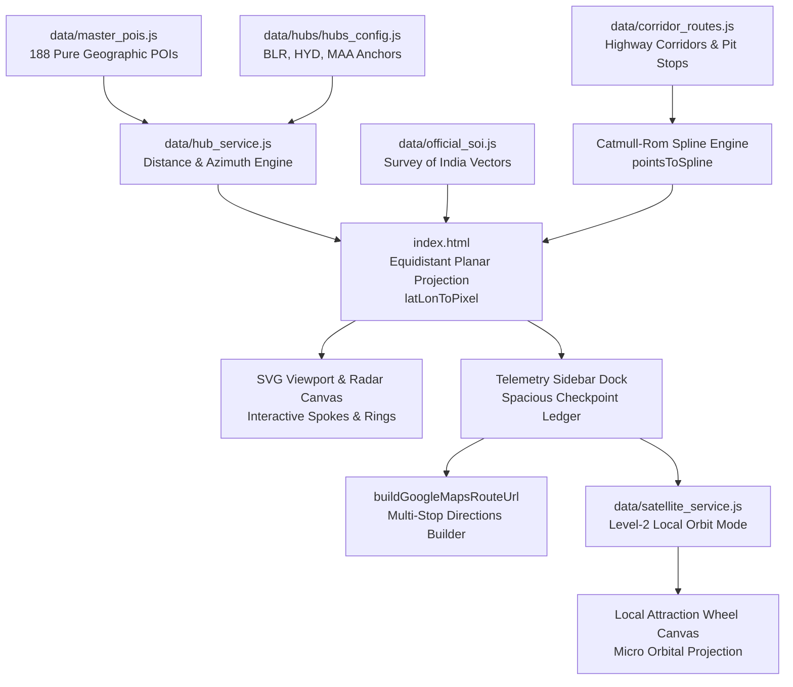

# 🛰️ Tactical GIS Road Trip Radar (Mission Control HUD)

An advanced, offline-first tactical Geographic Information System (GIS) and road trip telemetry engine built with vanilla HTML5, SVG, Web Animations API (WAAPI), and Survey of India vector cartography. Designed with a dark-mode military/aviation mission control aesthetic, the application delivers real-time route reconnaissance, highway corridor spline tracing, multi-select distance slicing, interactive milestone ledgers, multi-stop Google Maps navigation, and Level-2 Satellite Outpost Orbital exploration.

---

## 📸 Mission Control Interface Overview

```
+---------------------------------------------------------------------------------------------------+
|  [● LIVE] Origin: BENGALURU [12.97°N, 77.59°E] | 188 Outposts | Hub Switcher: [BLR] [HYD] [MAA]   |
+---------------------------------------------------------------------------------------------------+
|                                                 |  TACTICAL TELEMETRY SIDEBAR DOCK [430px]        |
|                  RADAR CANVAS                   |  ---------------------------------------------  |
|                                                 |  ROUTE: BENGALURU ➔ CHIKMAGALUR                 |
|               (500, 500 Hub Origin)             |  [ 245 KM ]            [ 4h 30m ]               |
|                                                 |  NH 75 Express Corridor  Avg Speed 54 km/h      |
|           / \           (Concentric             |  ---------------------------------------------  |
|          /   \           Range Rings:           |  ELEVATION PROFILE: ORIGIN 920M ➔ DEST 1090M    |
|         /     \          100-700 km)            |  [ Sparkline SVG / Western Ghats Ascent ]       |
|        /       \                                |  ---------------------------------------------  |
|       *---------*        (Active Highway        |  CORRIDOR CHECKPOINTS & PIT STOPS LEDGER        |
|      /  Outpost  \        Vector Ribbon:        |  +-------------------------------------------+  |
|     /             \       Catmull-Rom)          |  | ☕ Swathi Delicacy (Kumsi)         KM 85  |  |
|    *---*-------*---*                            |  |    Clean restrooms & South Indian filter  |  |
|         Milestones                              |  |    coffee. [ ✓ STOP ]                     |  |
|                                                 |  +-------------------------------------------+  |
|                                                 |  [ 🛰️ Launch Outpost Orbit / Local Recon ]     |
|                                                 |  [ 🌐 Open Route in Google Maps ]            |
+---------------------------------------------------------------------------------------------------+
|  RADAR RANGE FILTERS:  [All Ranges] [100 km] [200 km] [300 km] [400 km] [500 km] [600 km] [700 km] |
+---------------------------------------------------------------------------------------------------+
```

---

## 🌟 Key Architectural Features

### 1. Interactive Multi-Origin Metro Hub Switching
- Switch between three primary peninsular departure anchors:
  - **BLR (Bengaluru)**: `12.9716°N, 77.5946°E` — Plateau elevation 920 m
  - **HYD (Hyderabad)**: `17.3850°N, 78.4867°E` — Deccan plateau elevation 542 m
  - **MAA (Chennai)**: `13.0827°N, 80.2707°E` — Coromandel coast elevation 6 m
- Switching the hub re-centers the coordinate system, re-computes all road network vectors, recalculates driving times, updates concentric radar range circles, and dynamically repositions the Survey of India landmass vector layer.

### 2. Multi-Select Concentric Distance Slicing
- Bottom deck allows simultaneous multi-selection of distance brackets (`100 km`, `200 km`, `300 km`, `400 km`, `500 km`, `600 km`, `700 km`).
- Selected tiers trigger visual illumination on corresponding SVG radar range rings (`#radar-ring-{dist}`) with neon cyan glow and high-contrast stroke styling.
- Outpost nodes outside active cumulative distance ranges are cleanly faded and filtered out.

### 3. Highway Corridor Splines & Zero-Clutter Map Spokes
- Real-world highway paths are modeled as multi-point geographic vector chains (NH 44, NH 48, NH 75, NH 275, NH 16, NH 163, NH 30, etc.).
- Points are mathematically interpolated into smooth SVG Catmull-Rom ribbons (`pointsToSpline`) avoiding sharp polyline kinks.
- Active routes render an animated telemetry pulse tracer traveling seamlessly from origin to destination along the curved highway.
- **Zero-Clutter Canvas**: Canvas airspace is kept clean with minimalist milestone dots along the spoke; floating text labels on the map canvas are suppressed in favor of the dedicated sidebar ledger.

### 4. Spacious Corridor Checkpoints & Pit Stops Ledger
- Generous, premium card footprint in the expanded `430px` telemetry sidebar.
- Features glowing left-border HUD accents, 32px category icons, high-contrast typography, and milestone distance badges (e.g., `KM 85`).
- Checkpoint toggle action (`[ ✓ STOP ]` / `[ + ADD ]`) allows users to include or exclude specific pit stops dynamically.
- Smooth vertical scroll container with custom dark aviation scrollbars prevents viewport overflow or text clipping.

### 5. Bidirectional Cross-Highlighting
- Hovering over any checkpoint card in the sidebar ledger instantly highlights the corresponding milestone dot on the active map spoke with an illuminated cyan ring and ping beacon.
- Hovering milestone dots on the map canvas scrolls and illuminates the corresponding card in the sidebar ledger.
- Clean mouseleave listeners ensure hover states never get sticky or leave lingering DOM artifacts.

### 6. Dynamic Multi-Stop Google Maps Integration
- Direct export into native Google Maps using the Universal Directions URL schema:
  ```
  https://www.google.com/maps/dir/?api=1&origin={lat},{lon}&destination={lat},{lon}&waypoints={lat1},{lon1}|{lat2},{lon2}&travelmode=driving
  ```
- Dynamically reflects user-selected intermediate pit stops in real-time. Unselected or toggled-off checkpoints are automatically omitted.

### 7. Satellite Outpost Orbital Radar Mode (Level-2 Local Exploration)
- Locking onto any outpost reveals the `[ 🛰️ Launch Outpost Orbit / Local Recon ]` trigger.
- Seamlessly transitions from macro regional radar into a micro coordinate wheel centered on the destination outpost ("The Sun").
- Renders hyper-local points of interest across concentric `15 km`, `30 km`, and `45 km` local orbit rings.
- Curated constellations for flagship destinations (Sringeri, Ooty, Madurai, Chikmagalur, Coorg, Munnar, Hampi, Wayanad, Gokarna, Kodaikanal, Dantewada) paired with a universal dynamic generator for all 188 destinations.
- Local orbit scanner sweep, individual satellite node inspection, micro-elevation profiles, and one-click exit back to the regional macro radar.

---

## 📐 Projection Math & Coordinate Systems

### 1. Macro Regional Radar Projection
The regional radar utilizes an Equidistant Azimuthal-style planar cartesian projection centered at $(500, 500)$ on a $1000 \times 1000$ SVG canvas:

$$\Delta\text{lat} = \text{lat}_{\text{target}} - \text{lat}_{\text{hub}}$$
$$\Delta\text{lon} = \text{lon}_{\text{target}} - \text{lon}_{\text{hub}}$$

$$X = 500 + \left(\Delta\text{lon} \times 111.0 \times \cos\left(\frac{\text{lat}_{\text{hub}} \times \pi}{180}\right)\right) \times K_{\text{scale}}$$
$$Y = 500 - (\Delta\text{lat} \times 111.0) \times K_{\text{scale}}$$

Where:
- $111.0\text{ km/deg}$ represents the standard meridional distance per degree of latitude.
- $\cos(\text{lat}_{\text{hub}})$ provides local parallel longitude convergence compensation.
- $K_{\text{scale}} = 0.58\text{ px/km}$, mapping an $800\text{ km}$ operational radius precisely to $\approx 464\text{ px}$ from canvas center.

### 2. Micro Satellite Orbital Projection
When Level-2 Orbit mode is engaged, the coordinate frame resets locally around the outpost:

$$R_{\text{px}} = \left(\frac{D_{\text{km}}}{D_{\text{max}}}\right) \times 380\text{ px}$$
$$X_{\text{orbit}} = 500 + R_{\text{px}} \times \cos(\theta)$$
$$Y_{\text{orbit}} = 500 + R_{\text{px}} \times \sin(\theta)$$

Where $\theta$ is derived from the satellite's geographic bearing relative to the destination hub, and $D_{\text{max}} = 50\text{ km}$.

---

## 📂 File Inventory & Architecture

```
roadtripapp/
├── index.html                           # Main Single-Page Application (SVG Canvas, Telemetry HUD, WAAPI)
├── README.md                            # Comprehensive Technical Architecture & Setup Documentation
├── india_official_map_data.json         # Comprehensive GeoJSON vector dataset for India landmass & states
├── official_soi_simplified.json         # Optimized Survey of India vector coordinates for high-FPS SVG rendering
├── south_india_weekend_getaway_radar.html # Legacy Reference Implementation [READ-ONLY ARCHIVE]
├── data/
│   ├── master_pois.js                   # Master Registry: 188 curated destinations across 7 states
│   ├── master_pois.json                 # JSON counterpart for headless validation & tooling
│   ├── corridor_routes.js               # Highway vector corridors, Catmull-Rom spline engine & pit stops
│   ├── hub_service.js                   # Calibrated distance engine, Haversine math & drive time calculations
│   ├── satellite_service.js             # Level-2 Satellite constellations & local attraction generator
│   ├── official_soi.js                  # Survey of India vector landmass and shoreline JS module
│   └── hubs/
│       ├── hubs_config.js               # Anchor hub definitions (BLR, HYD, MAA)
│       ├── hubs_config.json             # JSON schema for origin hubs
│       ├── blr.js / blr.json            # Calibrated Bengaluru distance & drive time lookup tables
│       ├── hyd.js / hyd.json            # Calibrated Hyderabad distance & drive time lookup tables
│       └── maa.js / maa.json            # Calibrated Chennai distance & drive time lookup tables
└── scratch/                             # Unit tests, verification harnesses, and matrix calibration scripts
    ├── test_full_suite.js               # Master integration verification runner
    ├── test_satellite_orbital_recon.js  # Orbital recon & local attraction tests
    ├── test_multiselect_and_spacious_ledger.js # Range ring multi-select & ledger layout tests
    ├── test_zero_clutter_and_cross_highlight.js# Canvas decluttering & bidirectional hover tests
    ├── test_sidebar_width_and_multistop_maps.js# Sidebar layout & Google Maps URL builder tests
    ├── test_declutter_and_rogue_dot.js   # Telemetry card declutter & animation isolation tests
    ├── test_corridor_routes.js          # Highway spline and waypoint data verification
    ├── test_hub_centering.js            # Radar center anchoring & viewport transform tests
    ├── test_hud_switcher.js             # Hub switcher state machine verification
    ├── test_lockon_tracer.js            # Telemetry pulse tracer animation tests
    ├── test_distance_scale.js           # Concentric range ring verification (100–700 km)
    ├── test_drive_time_and_spoke_overlays.js # Drive time math & sign inversion tests
    ├── test_benchmark_builder.js        # Benchmark verification for calibrated highway road matrix
    └── check_kolhapur.js                # Drive time verification for long-range outposts
```

---

## 🔄 Data Flow Pipeline



---

## 🚀 Local Setup & Execution

The application is completely self-contained with **zero external CDN dependencies** and **no paid map API keys required**. It runs directly in any modern browser.

### Option 1: Direct File Launch
Double-click `index.html` or open it directly in Google Chrome, Microsoft Edge, Mozilla Firefox, or Safari:
```bash
# On Windows PowerShell
Start-Process "index.html"
```

### Option 2: Local Static Server (Recommended)
Running through a lightweight local HTTP server enables full SVG DOM introspection and seamless asset loading:
```bash
# Using Node.js npx
npx serve .

# Using Python
python -m http.server 8080
```
Navigate to `http://localhost:8080/index.html` in your browser.

---

## 🧪 Verification & Test Suites

The repository contains an extensive regression and integration test suite located in `scratch/`. All tests run headlessly in Node.js:

```bash
# Run the complete integration test suite
node scratch/test_full_suite.js

# Run Level-2 Satellite Orbit verification
node scratch/test_satellite_orbital_recon.js

# Run Multi-Select Range Rings & Ledger verification
node scratch/test_multiselect_and_spacious_ledger.js

# Run Zero-Clutter & Cross-Highlighting verification
node scratch/test_zero_clutter_and_cross_highlight.js
```

### All 14 Test Suites Status:
- `test_full_suite.js`: **PASS** (188 POIs, 3 Hubs, Elevation, HUD Switcher, Distance Tiers)
- `test_satellite_orbital_recon.js`: **PASS** (Curated & Algorithmic Constellations, Orbit Projection, SVG Sweeper)
- `test_multiselect_and_spacious_ledger.js`: **PASS** (Multi-select Rings, Illuminations, Card Dimensions, Toggle Badges)
- `test_zero_clutter_and_cross_highlight.js`: **PASS** (Milestone Dot Cross-Highlighting, Clean Hover-Out Reset)
- `test_sidebar_width_and_multistop_maps.js`: **PASS** (430px Sidebar, Google Maps Multi-Stop URL API)
- `test_declutter_and_rogue_dot.js`: **PASS** (Tracer Animation Isolation, Metadata Streamlining)
- `test_corridor_routes.js`: **PASS** (Catmull-Rom Spline Nodes, Checkpoints)
- `test_hub_centering.js`: **PASS** (Azimuthal Center Anchoring)
- `test_hud_switcher.js`: **PASS** (Origin Switching Logic)
- `test_lockon_tracer.js`: **PASS** (WAAPI Route Vector Pulse)
- `test_distance_scale.js`: **PASS** (100–700 km Tiers)
- `test_drive_time_and_spoke_overlays.js`: **PASS** (Drive Time Math & Display Formatting)
- `test_benchmark_builder.js`: **PASS** (Calibrated NHAI Road Matrix)
- `check_kolhapur.js`: **PASS** (Sign Inversion & Time Travel Bug Prevention)

---

## 🛡️ Invariant & Compliance Notice
- `south_india_weekend_getaway_radar.html` is an immutable reference document. File size is strictly pinned to **`125,084 bytes`**.
- Vector cartography is calibrated to the official Survey of India boundary parameters.

